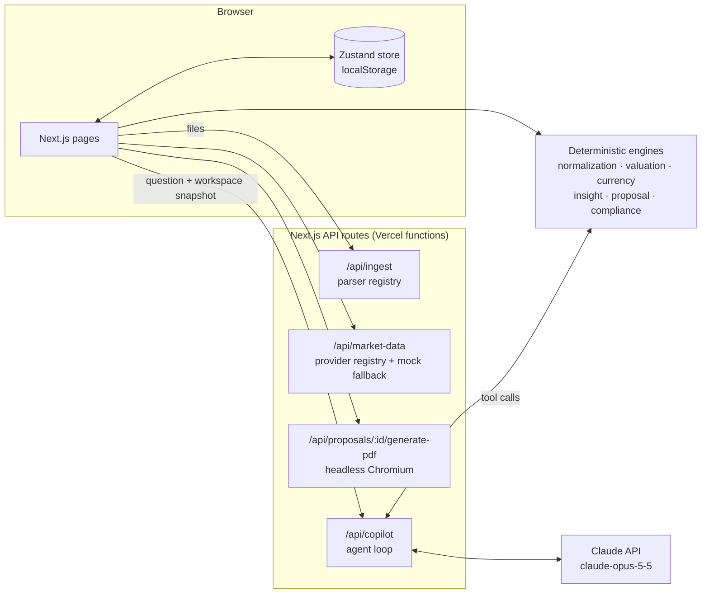

# Atlas Proposal Engine

**A reference implementation of AI-assisted wealth-proposal tooling.** Atlas takes an advisor from a pile of messy client statements to a branded, compliance-checked PDF proposal, with a Claude-powered Copilot that drafts recommendations and leaves every decision to the advisor.

**[Live demo →](https://atlas-proposal-engine.vercel.app/)** · runs on a sample family office, no sign-up, no API key needed

[](https://vercel.com/new/clone?repository-url=https%3A%2F%2Fgithub.com%2Ftylerbarnard23-PM%2Fatlas-proposal-engine)

> **Reference implementation, not production software.** Atlas has not been reviewed for compliance with SEC, FINRA or any other regulator's advertising, suitability or recordkeeping rules. Nothing it produces is investment, tax or legal advice. Don't use it with real client data.


## The problem

Before an advisor can propose anything, someone has to rebuild the client's balance sheet by hand: brokerage CSVs, a private-bank PDF in CHF, a screenshot of a crypto wallet, a K-1 capital account, a mortgage statement. Then they value it all in one currency, spot the problems, write the recommendations and check the disclosures. Most of that is clerical work, and the clerical work is where errors get in.

Atlas is built for advisors at RIAs and wealth platforms, and for the people building tools for them. It turns that prep into a pipeline you can review step by step.

## What it does

| Step | What happens | Where |
|---|---|---|
| **Ingest** | CSV, Excel, PDF text, OFX/QFX, pasted text and screenshots (OCR via Tesseract) are parsed into candidate holdings, each with a confidence level and a source trace back to the raw line. | Import Center, Statement Workbench |
| **Normalize** | Asset class, currency and identifier detection (ticker, CUSIP, ISIN, SEDOL); duplicate and data-quality checks; advisor verification status per holding. | Accounts & Assets |
| **Value** | Multi-currency valuation into the proposal's reporting currency. Market data comes from a provider registry (Finnhub, Twelve Data, Alpha Vantage, CoinGecko, ECB/Frankfurter FX, FRED, SEC EDGAR) and falls back to mock data, so it works without any keys. | Market Data |
| **Analyze** | A rules engine flags concentration, currency and country exposure, illiquidity, cash drag, high fees, manual valuations and data-quality problems. | Insights |
| **Recommend** | The advisor writes or converts recommendations; approved ones reshape the Before/After allocation, with sale proceeds flowing to cash in the same account. | Recommendations |
| **Ask the Copilot** | Claude investigates the portfolio through the engines and drafts recommendations for review. See below. | Proposal Copilot |
| **Check & publish** | A readiness checklist (unverified holdings, stale prices, approvals, required disclosures) gates a branded PDF rendered with headless Chromium. | Proposal Builder, PDF Preview |

## Proposal Copilot: the AI layer


The Copilot is a Claude agent (`claude-opus-5-5`) whose tools are Atlas's existing deterministic engines. The design rule is simple: **the model plans and writes; the engines do the math; the advisor decides.**

| Tool | Backed by |
|---|---|
| `get_portfolio_overview` | valuation + FX engines, `netWorth`, allocation summaries, recommendations already on file |
| `list_insights` | insight engine |
| `get_holding` | normalized holding, data-quality issues, verification status |
| `simulate_recommendation` | `applyRecToValue`, the same function behind the proposal's Before/After view |
| `check_proposal_readiness` | compliance readiness engine (same inputs as PDF Preview) |
| `draft_recommendation` | creates a recommendation draft (the only write the agent can make) |

**Guardrails, enforced in code rather than in the prompt:**

- **Drafts can't be approved by the model.** `draft_recommendation` hard-codes `approvedByAdvisor: false`, `includeInPdf: false` and `status: "needs_review"`. Extra fields a model sends are dropped by schema validation, and a test checks this.
- **No numbers from the model.** Every figure in an answer comes from a tool result, and the UI shows the full tool trace ("What the agent did").
- **Statement text is untrusted.** Holding names and notes come from uploaded documents; the system prompt treats them as data and the tools never execute anything they contain.
- **Bounded.** At most 10 agent turns and 5 drafts per request; requests are size-capped and validated with Zod; refusals fall back server-side (`fallbacks: "default"`).
- **Nothing is persisted server-side.** The workspace lives in the browser; each request sends the slice the agent needs.

**Demo mode.** Without `ANTHROPIC_API_KEY`, the Copilot runs a scripted planner that calls *the same tools* in a fixed order. The public demo costs nothing to run, and the tool layer has a deterministic regression baseline. The demo planner also has some judgment of its own: it won't draft a sale of an illiquid position (a primary residence, an LP interest), and it skips holdings that already have a recommendation.

## Architecture



The engines in `src/engines` are pure TypeScript functions shared by the UI and the server, so the Copilot, the Before/After charts and the PDF can never disagree.

```
src/
  app/            pages + API routes (Next.js App Router)
  copilot/        agent loop, tool layer, demo planner, request validation
  engines/        normalization, valuation, currency, insight, proposal, compliance
  ingestion/      parsers, providers, normalizers, validation, sample statements
  market-data/    provider registry, caching, freshness checks
  pdf/            proposal template + Chromium resolution
  store/          Zustand workspace store
tests/            unit tests + extraction eval
```

## Tests and evals

```bash
npm test        # 31 unit tests + the eval: proposal math, cash flows, readiness, insights, Copilot guardrails
npm run eval    # statement-extraction accuracy scorecard
```

The extraction eval runs the parsers over the sample statements against hand-labelled holdings and scores recall, label accuracy, currency accuracy and spurious rows. Its first run found real bugs: amounts written as `CHF 193,864.00` didn't parse, and bond face value was being read as market value. Fixing the parser to use the statement's header row took recall from **61.9% to 100%** and spurious rows from **5 to 0**. Those numbers are now the floor the eval allows.

| Statement | Holdings | Found | Currency |
|---|---|---|---|
| Brokerage CSV | 5 | 5 | 5 |
| Retirement CSV (no currency column) | 4 | 4 | left blank, flagged for review |
| Swiss private bank, messy paste (CHF) | 4 | 4 | 4 |
| Crypto wallet, OCR text | 3 | 3 | 3 |
| Trust statement, bonds by CUSIP | 3 | 3 | 3 |
| Bank statement (EUR) | 2 | 2 | 2 |

## Quickstart

Requires Node 24.

```bash
git clone https://github.com/tylerbarnard23-PM/atlas-proposal-engine.git
cd atlas-proposal-engine
npm install
npm run dev
```

Open http://localhost:3000. The app loads with a sample client (the Blackwell Family Office); **Settings** resets the sample or clears to a blank workspace.

To try the Copilot with Claude, copy `.env.example` to `.env.local` and set `ANTHROPIC_API_KEY`. Everything else is optional:

| Variable | Purpose |
|---|---|
| `ANTHROPIC_API_KEY` | Enables the live Copilot. Without it, demo mode. |
| `COPILOT_MODE=demo` | Forces demo mode even with a key (e.g. a public deployment). |
| `FINNHUB_API_KEY`, `TWELVE_DATA_API_KEY`, `ALPHA_VANTAGE_API_KEY`, `FRED_API_KEY` | Live market data. Without them, free providers and mock fallbacks. |

## Limitations and roadmap

- State lives in the browser. There are no accounts, no database and no audit trail, all of which a real advisory platform needs.
- Market data, FX and the insight thresholds are illustrative, not calibrated.
- The Copilot doesn't yet read raw statements; the next step is a Claude extraction pass over low-confidence rows, measured with the same eval.
- Compliance checks are a readiness checklist, not a compliance review.

Feedback and issues welcome.

## License

No license file yet: all rights reserved by the author until one is added.
