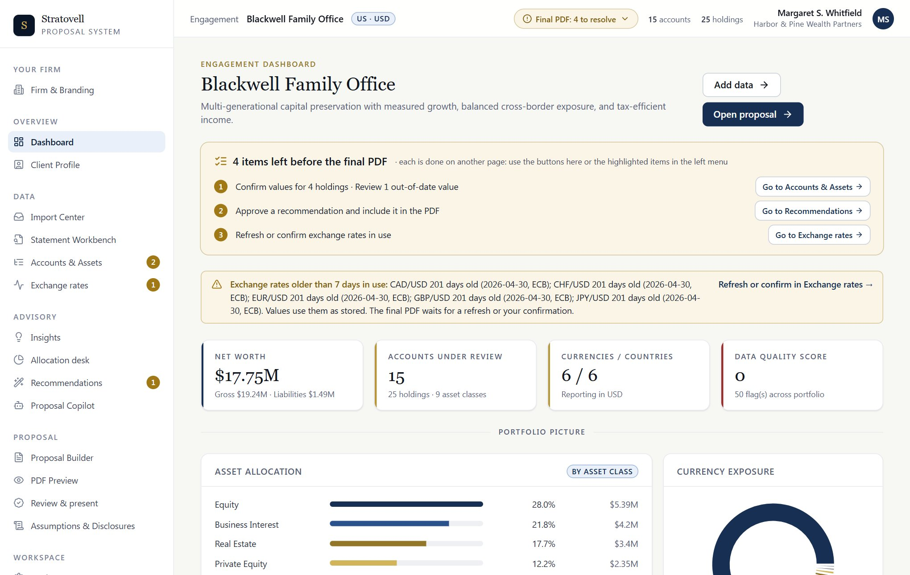
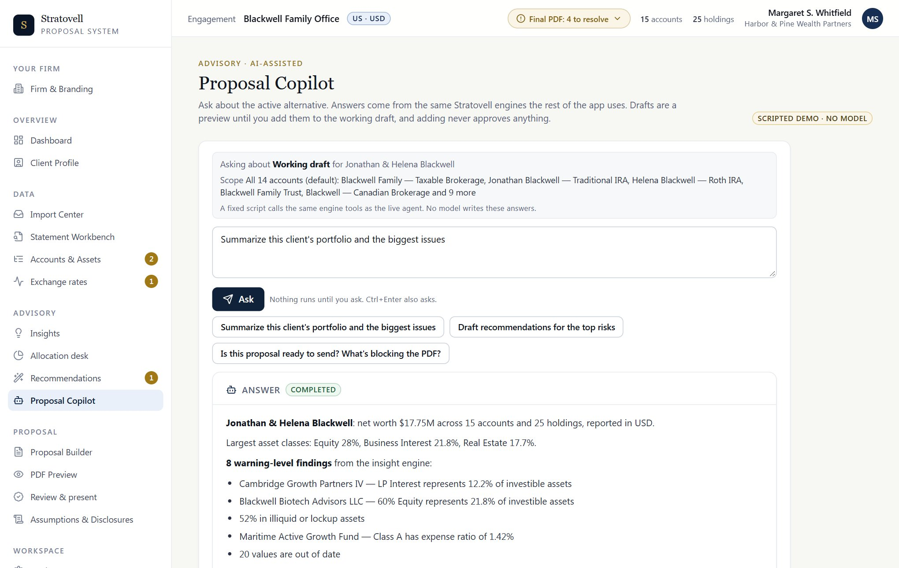
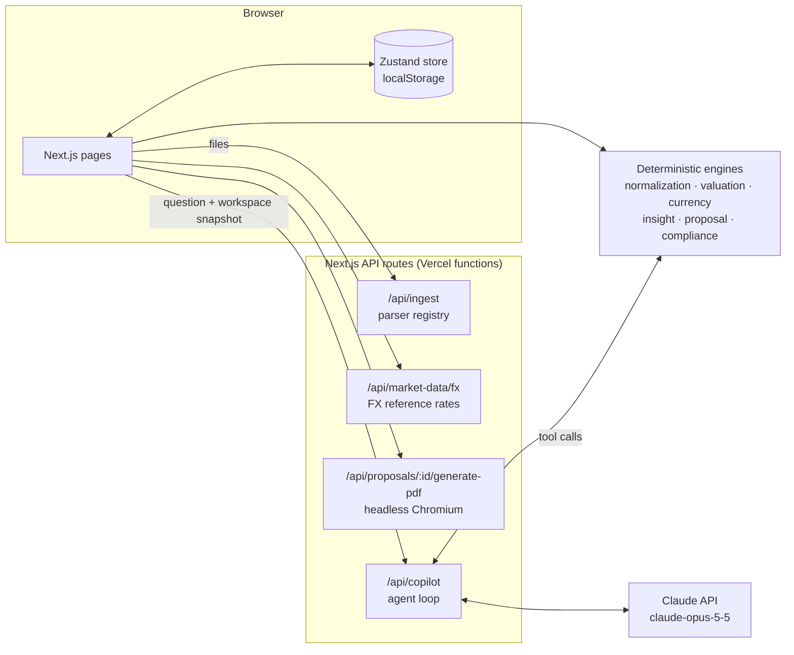

# Stratovell Proposal System

> **Formerly Atlas Proposal Engine.** The repository, live-demo URL, package name and browser-storage and backup identifiers keep the `atlas-proposal-engine` name, so existing links, saved workspaces and backups keep working.

**A demonstration of AI-assisted wealth-proposal tooling.** Stratovell takes an advisor from a pile of messy client statements to a branded sample PDF proposal gated by a readiness checklist, with Stratovell AI, which uses Claude to review portfolio information against the advisor's client discovery and prepare recommendations for advisor review, leaving every decision to the advisor.

[](https://github.com/tylerbarnard23-PM/atlas-proposal-engine/actions/workflows/ci.yml)

**[Live demo →](https://atlas-proposal-engine.vercel.app/)** · runs on a sample family office, no sign-up, no API key needed

> **Disclaimer.** Stratovell is a demonstration project. It is not a registered investment adviser or broker-dealer and is not affiliated with, reviewed, or endorsed by the SEC, FINRA, or any regulator. Sample clients and advisors are fictional. Nothing here is investment, tax, or legal advice. Do not upload real client data.
>
> Stratovell is a reference implementation, not production software, and has not been reviewed for compliance with SEC, FINRA or any other regulator's advertising, suitability or recordkeeping rules.



## Why it matters: the advisor stays in control

Stratovell's value is a proposal an advisor can defend line by line. Portfolio calculations use shared deterministic engines. Stratovell AI's figures are checked against tool results; unsupported or unchecked claims are flagged for advisor review. The advisor chooses the scope (which accounts the proposal is about), sizes each change, approves it explicitly, and then freezes an approved version that later edits can't rewrite. The product refuses to approve a version or issue a final PDF until a readiness checklist passes, and says what is blocking. Nothing is sent, traded or filed: it produces a sample document and a read-only meeting view.

**See it in five minutes:** the [demo walkthrough](docs/roadmap/D5_DEMO_WALKTHROUGH.md) goes scope → proposed change → explicit approval → approved version → PDF, with a blocked-readiness example, and records what was and wasn't rehearsed.

**What has and hasn't been evidenced.** The public demo is scripted (no model, no key). One owner-operated run against real Claude passed on 16 November 2026 (one question, synthetic data, a spend-limited Console workspace, about USD 0.07). The 27-trial agent evaluation, the real-model browser checks and any study with advisors have **not** been performed; the [usability protocol](docs/roadmap/R25_USABILITY_PROTOCOL.md) and its [scorecard](docs/roadmap/R25_SCORECARD.md) are prepared and empty, so there are no usability or time-saving claims.

## The problem

Before an advisor can propose anything, someone has to rebuild the client's balance sheet by hand: brokerage CSVs, a private-bank PDF in CHF, a screenshot of a crypto wallet, a K-1 capital account, a mortgage statement. Then they value it all in one currency, spot the problems, write the recommendations and check the disclosures. Most of that is clerical work, and the clerical work is where errors get in.

Stratovell is built for advisors at RIAs and wealth platforms, and for the people building tools for them. It turns that prep into a pipeline you can review step by step.

## What it does

| Step | What happens | Where |
|---|---|---|
| **Ingest** | CSV, Excel, PDF, OFX/QFX, pasted text and screenshots (OCR via Tesseract) are parsed into candidate holdings, each with a confidence level and a source trace back to the raw line. PDFs are read in the browser with pdf.js (nothing is uploaded) and rebuilt into layout-aware lines; financial plans with a Balance Sheet (LifeView-style) are recognized and loaded as a client with one account per asset or liability, **reconciled against the document's own totals**. | Import Center, Statement Workbench |
| **Normalize** | Asset class, currency and identifier detection (ticker, CUSIP, ISIN, SEDOL); duplicate and data-quality checks; advisor verification status per holding. | Accounts & Assets |
| **Value** | Multi-currency valuation into the proposal's reporting currency. Holding values come from statements, advisor entry and advisor-approved values, each shown with its own source and recorded date; Stratovell doesn't reprice securities. Exchange rates come from Frankfurter (ECB reference rates) or rates added by hand, with no key needed. A holding with no usable exchange rate is shown as *not valued* (never converted at 1:1 or counted as zero): totals say what they exclude, portfolio-wide conclusions pause, and the final PDF stays blocked until it's valued. An FX refresh merges by currency pair and keeps rates the provider didn't return with their own dates; rates in use older than 7 days (an initial product policy) are flagged and need a refresh or the advisor's expiring confirmation before the final PDF, which lists the rates it used. | Exchange rates |
| **Check** | Portfolio checks: built-in rules report concentration, currency and country exposure, illiquid assets, cash share, fund expense ratios, manual valuations and data-quality problems, each with its observed figure, a product-default threshold (not a regulatory limit or the client's policy), scope, valuation dates and limits. A check never creates a recommendation. No model involved. | Stratovell AI → Portfolio checks |
| **Recommend** | The advisor writes recommendations, or reviews and edits the drafts Claude prepares; each record shows its origin (Claude draft, advisor-authored, scripted/test/sample example, or not recorded); approved ones reshape the Before/After allocation, with sale proceeds flowing to cash in the same account. Amounts keep the currency they were entered in and are converted into the reporting currency at the workspace's current rates, with the rate, source and date shown; changing a recommendation's currency means converting its amounts or entering new ones, and editing an approved recommendation's amounts clears the approval. The editor shows a live preview simulated with the full proposal engine: current and proposed value, signed and percentage change, the cash it actually moves (including household cash for debt paydowns) and any shortfall, without saving anything. A workspace starts with no recommendations (the sample portfolio included); when a saved workspace holds the prewritten samples, a notice says they demonstrate the workflow and weren't generated by Claude or from discovery. | Recommendations |
| **Design** | The Allocation desk sets the investment scope (context assets and liabilities stay out of the weights), shows current, proposed and target asset-class weights with drift and actual cash, and previews one working draft of explicit position edits through the same proposal engine. Targets create no trades; previews change no holdings or approvals. It also builds funded alternatives: replace into a new investment with linked sell/buy legs applied together, fund purchases only from an account's chosen eligible cash, keep a minimum reserve, and compare named alternatives. | Allocation desk |
| **Discover** | An advisor-completed client discovery: objectives, time horizon, liquidity and income needs (each amount with its own currency and period), willingness and ability to accept losses (kept separate), tax sensitivity and constraints. Every question starts as "Not discussed yet"; older profile values are never read as answers; each answer carries a dated advisor review that goes stale when it changes. | Client objectives |
| **Analyze with Stratovell AI** | Claude investigates the portfolio through the engines against the reviewed client brief, compares alternatives with simulations and drafts recommendations for review. See below. | Stratovell AI, or beside the Allocation desk |
| **Brand** | White-label: the adviser's firm name, advisor of record, logo and accent color brand every proposal. Set once and kept when starting a new client. Logos are uploaded raster images re-encoded in the browser; the PDF server never fetches a URL. | Firm & Branding |
| **Check & publish** | A readiness checklist (unverified holdings, stale prices, approvals, required disclosures) gates the final PDF, in the UI and on the server. Each open item links to the page where it's fixed. PDFs are rendered with headless Chromium and marked as samples. | Proposal Builder, PDF Preview |

## Stratovell AI: the AI layer



Stratovell AI is a Claude agent (`claude-opus-5-5`) whose tools are Stratovell's existing deterministic engines. The advisor records the client's objectives. Stratovell checks the portfolio data and calculates possible changes. Claude analyzes that information and prepares recommendations for advisor review and approval. The design rule: **the model plans and writes; the engines do the math; the advisor decides.** Without a live Claude connection, no AI recommendation is generated for the client: local Stratovell offers Connect Claude, and the hosted demo offers only a separately chosen, labelled scripted example (the server refuses to substitute a script or the test provider for a request made for Claude).

| Tool | Backed by |
|---|---|
| `get_portfolio_overview` | the client brief (the advisor's discovery answers with their review status, what wasn't discussed, possible conflicts and missing details; never names or the private discovery notes), valuation + FX engines, `netWorth`, allocation summaries, recommendations already on file |
| `list_insights` | the portfolio checks (insight engine), each with its basis; facts to analyze, not recommendations |
| `get_holding` | normalized holding, data-quality issues, verification status |
| `simulate_recommendation` | `applyRecToValue`, the same function behind the proposal's Before/After view |
| `get_scope_overview` | the allocation desk's evaluator over the active alternative: scope totals and weights, household context, blocked actions, shortfalls, reserves, input revision (D4) |
| `simulate_scope_change` | `previewDraftEdit` + `evaluateDesk`: one position change in the active alternative, before and after; reports blocks, new shortfalls and reserve breaches (D4) |
| `check_proposal_readiness` | compliance readiness engine (same inputs as PDF Preview) |
| `draft_recommendation` | creates an unapproved draft (the only write the agent can make); a position change must be the exact action a scope simulation evaluated |

**Three labelled modes.** The public demo never calls a model, and the page shows which mode answered before and with every answer.

- **Demo mode** (the default, and what the live site runs): a scripted planner calls *the same tools* in a fixed order and writes its answer and draft rationales from fixed templates filled with the values those tools return. It costs nothing to run and gives the tool layer a deterministic regression baseline. It also applies a few rules of its own: it won't draft a sale of an illiquid position (a primary residence, an LP interest), and it skips holdings that already have a recommendation.
- **Test provider** (`COPILOT_MODE=test`): a deterministic scripted client runs through the *real* agent loop and tools. It is labelled "Test provider · not a model", makes no API calls and exists for end-to-end checks; it is never evidence of model behaviour.
- **Live mode** (local only; see [Local Claude setup](docs/roadmap/LOCAL_CLAUDE_SETUP.md)): Claude chooses which tools to call and writes the answer and the draft text itself. The page shows the requested and actual model (a server-side refusal fallback is shown as such). You connect your own Anthropic API key under **AI connection** (**Connect Claude**) and start a limited session there: at most 30 minutes, 3 runs, 10 HTTP requests, one run at a time and a USD 5 estimate-based guard. Without a connected key and a session, live requests are refused before any provider call. Real Claude has exercised this path only in a few owner-operated single runs on synthetic data; the 27-trial agent evaluation hasn't been performed.
- **Hosted mode** (#113, in review; not set up on the public site yet; see [Hosted Claude](docs/roadmap/HOSTED_CLAUDE.md)): the shared site shows the labelled scripted demonstration to everyone ("Scripted demonstration · Claude is not connected."). A user who signs in with GitHub connects their **own** Anthropic API key (encrypted on the server, never shown again; saving it contacts nobody), starts a session with the same limits as live mode and explicitly runs Claude analysis. There is no owner-funded key. It needs a Postgres database, an encryption secret and a GitHub OAuth app, which the owner sets up.

**The client brief (#109).** Before asking, the advisor sees the "Client brief for analysis": recorded answers with their review status, what wasn't discussed, possible conflicts and missing details, an editable note for the analysis, and the exact text a live analysis sends to Anthropic. The model receives that brief through `get_portfolio_overview`; it relates its analysis to the stated objectives and asks targeted follow-up questions instead of inventing client facts. Amounts are client instructions with their own currency and period, never reserves the engines enforce. Changing an answer (or its review) changes the input revision, so an earlier preview can't be added.

**Enforced in code** (both modes, covered by tests):

- **Draft-only authority.** The only write the agent can make is `draft_recommendation`, which hard-codes `approvedByAdvisor: false`, `includeInPdf: false` and `status: "needs_review"`. Fields a model adds to try to approve its own draft are stripped by schema validation; a test sends them and checks they're ignored.
- **Schema validation.** Requests and every tool input are validated with Zod; unknown holding ids and invalid values come back as tool errors.
- **Execution limits.** At most 10 agent turns, 24 tool calls, 48,000 output tokens, 100 seconds, 2 retries of a failed request (tools never re-run) and 5 drafts per request; request bodies are capped at 1 MB. Every run ends with an explicit status (completed, refused, truncated, a limit, cancelled or failed) and lists the drafts prepared so far (previews until the advisor adds them). Live mode needs a local server and request, a key connected by a paired browser, and that browser's session with allowance left.
- **Context-bound (D4).** Each request names the client, the active alternative, its scope and an input revision; the server rejects a mismatch (409), and accepting a draft re-checks the revision, so an answer about changed inputs or another alternative can't be accepted.
- **Preview, then explicit acceptance (D4).** Drafts are a preview computed with the desk's evaluator ("Preview only — nothing added"); nothing is saved until the advisor chooses **Add to working draft**, which adds them to the active alternative as unapproved actions ("Added to working draft — awaiting approval"), with a link to find them on Recommendations. Acceptance is idempotent (deterministic draft IDs) and never touches holdings, approvals or approved versions. Simulations fail closed on out-of-scope positions, cash, missing values or rates, incomplete imports, blocked units, new shortfalls, reserve breaches and duplicates. Tools to approve, finalize, share or execute don't exist; calls to them are refused and counted.
- **Figures are checked.** Amounts and percentages in an answer and in draft rationales are matched against typed tool results from that run, by value, unit, currency and any written sign. Figures inside workspace text (holding, account and file names, notes, titles, rationales) are neither evidence nor claims. Unsupported figures are flagged. Claims that can't be decided (a bare number, or an unsigned amount the engine has only as a negative change) are listed as unchecked, never as matched.
- **Minimized and unlogged.** The client's and household's names, the advisor's name and email, and import file names are replaced where Stratovell recognizes them in model-bound text, the question included. This is minimization, not anonymization: holdings, values, account details and anything else typed into a question still reach the model. Prompts, tool payloads, reasoning and keys are not logged.
- **The key stays on the local server.** A key pasted under Connect Claude is kept in the server's memory or the operating system's credential store, as the user chooses. It is never returned to the browser, written to the workspace or a backup, or logged. Saving it makes no provider request.
- **The engines do the math.** Tools compute every figure with the same deterministic engines as the Before/After view and the PDF, and the tools are read-only apart from creating drafts.
- **Nothing is persisted server-side.** The workspace lives in the browser; each request sends the slice the agent needs.

**Required by the system prompt, not validated by code** (live mode):

- **Numbers come from tool results.** The prompt tells the model to state only figures the tools returned and not to do its own portfolio arithmetic. Figures in the answer and in draft rationales are checked against that run's tool results and flagged when unsupported (above), but a flagged answer is still shown, and wording around a figure isn't validated. A draft's rationale is free text, and once the advisor approves it and includes it in the PDF it is printed as written, so the advisor should check its figures against the tool trace ("What the agent did") shown under every answer.
- **Behavioral instructions.** Not claiming a recommendation is approved, final or suitable; not projecting returns; treating holding names and statement text as data rather than instructions; flagging compliance and tax questions. The tools never execute text from documents, but the model's own wording isn't validated.

## Architecture



The engines in `src/engines` are pure TypeScript functions shared by the UI and the server, so Stratovell AI, the Before/After charts and the PDF can never disagree.

```
src/
  app/            pages + API routes (Next.js App Router)
  copilot/        agent loop, tool layer, demo planner, request validation
  engines/        normalization, valuation, currency, insight, proposal, compliance
  ingestion/      parsers, providers, normalizers, validation, sample statements
  market-data/    FX reference rates; legacy security-quote adapters (no page uses them; retirement planned)
  pdf/            proposal template + Chromium resolution
  store/          Zustand workspace store
tests/            unit tests + extraction eval
```

## Tests and evals

```bash
npm test        # 907 tests in 54 files (2 need the private UBS PDF and are skipped without it, as in CI): the Stratovell AI agent loop with an injected fake provider (no key, no spend), local pairing, key handling and sessions with fake credential stores, proposal math and currency handling, calendar dates across time zones, workspace backup and restore, recommendation currencies and previews, cash flows, readiness, insights, CSV/Excel/PDF import and import completeness
npm run eval    # statement-extraction accuracy scorecard
npm run eval:agent:live   # opt-in PAID live agent evaluation; refuses to run without explicit flags, a key and a spend cap. The cap is an estimate-based guard, not a guaranteed ceiling (see docs/roadmap/AGENT_EVALUATION.md)
```

CI runs the type check, tests, eval and production build on every pull request.

The extraction eval runs the parsers over the sample statements against hand-labelled holdings and scores recall, label accuracy, currency accuracy and spurious rows. Its first run found real bugs: amounts written as `CHF 193,864.00` didn't parse, and bond face value was being read as market value. Fixing the parser to use the statement's header row took recall from **61.9% to 100%** and spurious rows from **5 to 0**. Those numbers are now the floor the eval allows.

### PDF statements: what's verified

PDF import is verified on the document types below, not on PDFs in general. Anything else falls back to a line-based table reader that may miss or misread rows; the reconciliation and completeness checks exist so that shows up instead of passing silently.

- **Statement with a simple holdings table** (one row per line, an explicit "Total Account Value" / "Grand Total" line): synthetic fixtures for issue #29. Section totals ("Total Equities") and subtotals are never holdings and never stand in for the account total; conflicting account totals are a mismatch to review; the total keeps its own currency.
- **Holdings report laid out as a positioned table** (landscape pages stored rotated, right-aligned columns under stacked headers, wrapped names, section headings, balanced funds unbundled across asset classes): read by column geometry from the market-value column. Verified against a 13-page third-party sample report (UBS's public "Portfolio Holdings Report" sample, not committed; its tests run when the file is placed in `tests/fixtures/private/`): all **68** detailed positions, which add up to $10,648,193.74 against the stated **$10,648,193.73**. The one-cent difference is per-row rounding, inside the tolerance of half a cent per row ($0.34 for 68 rows); a larger gap is reported as a mismatch, never balanced. Summary tables, subtotals, the repeated "Total Portfolio", footnotes, disclosures and the blended balanced-fund summary are excluded. A committed synthetic report reproduces the layout.
- **Financial plan (LifeView-style Balance Sheet)**: see below.

Known limits: the positioned-table reader needs the market-value column label ("Market value" / "Current value") and right-aligned numbers; a consolidated report that doesn't say which account holds each position is imported into one account (none is invented); no symbols or identifiers are inferred when the document has none; a price or cost basis printed as 0.00 next to a real value is treated as unavailable.

**Incomplete imports.** An import whose rows don't reach the document's stated total, that left rows out as unreadable, or that has no total to check against is stored as incomplete (or of unknown completeness) with its source document. Until it's resolved (a complete re-import, or removing that import's holdings), the final PDF is blocked in the UI and on the server, the dashboard, Accounts & Assets and Recommendations say so, recommendations on its holdings are badged, and Stratovell AI refuses trade-sizing drafts. Confirming the imported values doesn't clear it.

The financial-plan reader was built against a real 94-page planning report (Morgan Stanley's public LifeView marketing sample, which isn't committed here): it reads all 21 Balance Sheet lines and matches the report's stated assets ($27,997,288), liabilities ($3,520,000) and net worth ($24,477,288) to the dollar. The committed eval case is a synthetic look-alike written from scratch.

| Statement | Holdings | Found | Currency |
|---|---|---|---|
| Brokerage CSV | 5 | 5 | 5 |
| Retirement CSV (no currency column) | 4 | 4 | left blank, flagged for review |
| Swiss private bank, messy paste (CHF) | 4 | 4 | 4 |
| Crypto wallet, OCR text | 3 | 3 | 3 |
| Trust statement, bonds by CUSIP | 3 | 3 | 3 |
| Bank statement (EUR) | 2 | 2 | 2 |
| Financial plan, Balance Sheet (synthetic, 2 pages + liabilities) | 11 | 11 | 11 |

## Quickstart

These technical instructions do not grant a software license. Check the [licensing notice](LICENSING.md) for the version/material you intend to use; historical MIT grants are not withdrawn by this notice.

Requires Node 24.

```bash
git clone https://github.com/tylerbarnard23-PM/atlas-proposal-engine.git
cd atlas-proposal-engine
npm install
npm run dev
```

Open http://localhost:3000. The app loads with a sample client (the Blackwell Family Office); **Settings** resets the sample or clears to a blank workspace.

To use Stratovell AI with your own Claude API key on this machine:

```bash
npm run build
npm run local
```

`npm run local` starts Stratovell on `127.0.0.1` only and opens it paired with your browser. Then open **Stratovell AI → AI connection → Connect Claude**: create a dedicated Console workspace with a spend limit, paste a standard API key, choose whether Stratovell remembers it, and start a limited session. `npm run local:doctor` checks the machine without contacting Anthropic. The full guide, limits and security design are in [Local Claude setup](docs/roadmap/LOCAL_CLAUDE_SETUP.md). API usage is billed to your Console account. The public demo deliberately runs without a key, and live mode refuses on a hosted deployment. Everything except one run was built and tested with fake providers; on 16 November 2026 the owner ran this path once against real Claude (one question, synthetic data, a dedicated Console workspace with a spend limit, 4 provider requests, about USD 0.07 estimated, no fallback model). That single run is not the 27-trial agent evaluation or the broader real-model browser checks, which have not been performed. Everything else is optional:

| Variable | Purpose |
|---|---|
| `ANTHROPIC_API_KEY` | Advanced, optional: a key managed outside Stratovell. It is used only after you choose "Use the server's environment key" under Connect Claude. `npm run local` sets `COPILOT_MODE=live` for you; `COPILOT_MODE=test` runs the deterministic test provider; anything else is demo mode. |
| `FINNHUB_API_KEY`, `TWELVE_DATA_API_KEY`, `ALPHA_VANTAGE_API_KEY`, `FRED_API_KEY` | Optional legacy security-quote enrichment, not a proposal requirement: no page calls the quote routes, and proposals use statement, advisor-entered and approved values. Leave them unset; their retirement is planned (R18). |

## White-label and sample output

Stratovell is white-label: clients see the adviser's firm, logo and colors, not Stratovell. The sample firm, **Harbor & Pine Wealth Partners**, is fictional, and its name is deliberately unrelated to the product. Disclosures refer to the adviser as `[Firm]` until a real firm name is set in Firm & Branding.

Every PDF Stratovell generates is marked as a sample: a SAMPLE watermark on final PDFs (DRAFT on drafts), the complete sample notice on the cover and at the foot of every other physical page, including continuation pages of a long section ([#94](https://github.com/tylerbarnard23-PM/atlas-proposal-engine/issues/94); checked page by page in a real-Chromium test), and a `SAMPLE_` filename prefix. The same disclaimer appears in the app footer. These markings are intentional and stay in this repository.

> **Stratovell on client documents.** The sample notice (`PDF_SAMPLE_NOTICE` in `src/domain/legal.ts`, the SAMPLE watermark and cover label, and the `SAMPLE_` filename prefix) is the Stratovell attribution on the cover and at the foot of every other page of the document. The product name also appears in the approved-version note ("a local Stratovell record") and in the two statements that Stratovell does not reprice securities or use a price feed; the advisor's firm name and branding stay as the advisor set them. An adopter with the necessary rights would need its own reviewed output policy; sample markings are not a licensing permission or a compliance approval.

Any authorized adaptation for real client work also requires the relevant production controls and review before removing sample markings: compliance review, books-and-records retention, supervision, data security and vendor due diligence are the responsibility of whoever deploys it.

## Limitations and roadmap

**Approved scope adjustment (planning only, 22 October 2026):** the core proposal journey will use verified statement/imported account values or explicit advisor-approved valuations, retaining FX, dates, provenance and financial safeguards. Broad security pricing/research will become optional; safe retirement of unnecessary integrations is planned, not implemented. See the [valuation scope and migration plan](docs/roadmap/VALUATION_SCOPE.md). R18 slice 1 removed security quotes from the ordinary UI and corrected the value-source wording in the Dashboard and PDF; the quote adapters and routes remain in the codebase until their planned retirement.

**Delivery status (18 November 2026):** the [five demo packages](docs/roadmap/DEMO_DELIVERY_PLAN.md) D1–D4 (scope and allocation desk, funded alternatives, approved versions and the meeting view, the bounded agent) are released, and the D5 packaging (rename, walkthrough, usability protocol, the sample notice on every PDF page) is released and production-verified. The desktop [recording package](docs/roadmap/D5_RECORDING_PACKAGE.md) is in review. The [Claude command playbook](docs/roadmap/CLAUDE_COMMANDS.md) holds the next task. Full advanced features remain later.

The **[accepted 25-item advisor roadmap](ROADMAP.md)** has detailed plans, dependencies, phases and linked issues. Planned features are separate from the capabilities above. Start implementation with **[the roadmap guide](docs/roadmap/IMPLEMENTATION_GUIDE.md)** and the current handoff.

- State lives in the browser. There are no accounts, no database and no audit trail, all of which a real advisory platform needs.
- Market data, FX and the insight thresholds are illustrative, not calibrated.
- Stratovell AI doesn't yet read raw statements; the next step is a Claude extraction pass over low-confidence rows, measured with the same eval.
- Compliance checks are a readiness checklist, not a compliance review.
- No advisor usability study has been run, and no accessibility conformance is claimed. Known gaps from the walkthrough rehearsal: no navigation below 768 px ([#92](https://github.com/tylerbarnard23-PM/atlas-proposal-engine/issues/92)) and no skip link ([#93](https://github.com/tylerbarnard23-PM/atlas-proposal-engine/issues/93)); both are deferred while the demo targets desktop, and a draft implementation is parked in PR #98.
- The name is preliminary-screened only: not trademark or legal clearance.

Feedback and issues welcome.

## License

See [LICENSING.md](LICENSING.md) for current licensing intent and the historical MIT notice. The current project does not offer a new blanket open-source license. Historical grants and third-party licenses are preserved; rights verification is not represented as complete.
