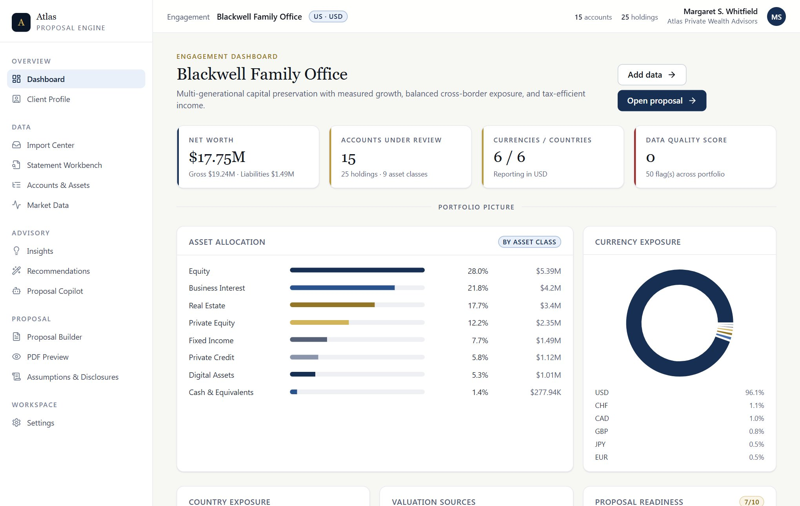
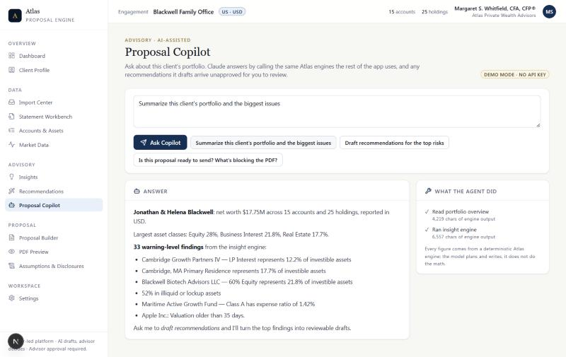
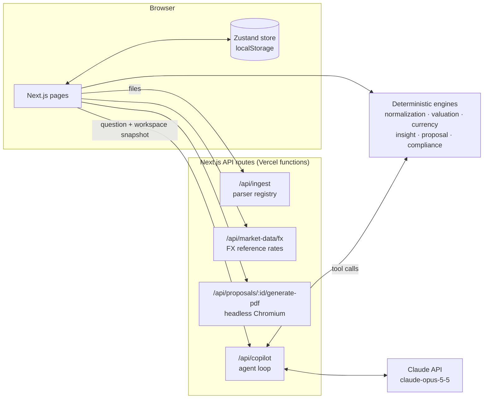

# Atlas Proposal Engine

**A demonstration of AI-assisted wealth-proposal tooling.** Atlas takes an advisor from a pile of messy client statements to a branded sample PDF proposal gated by a readiness checklist, with a Claude-powered Copilot that drafts recommendations and leaves every decision to the advisor.

[](https://github.com/tylerbarnard23-PM/atlas-proposal-engine/actions/workflows/ci.yml)

**[Live demo →](https://atlas-proposal-engine.vercel.app/)** · runs on a sample family office, no sign-up, no API key needed

> **Disclaimer.** Atlas is a demonstration project. It is not a registered investment adviser or broker-dealer and is not affiliated with, reviewed, or endorsed by the SEC, FINRA, or any regulator. Sample clients and advisors are fictional. Nothing here is investment, tax, or legal advice. Do not upload real client data.
>
> Atlas is a reference implementation, not production software, and has not been reviewed for compliance with SEC, FINRA or any other regulator's advertising, suitability or recordkeeping rules.



## The problem

Before an advisor can propose anything, someone has to rebuild the client's balance sheet by hand: brokerage CSVs, a private-bank PDF in CHF, a screenshot of a crypto wallet, a K-1 capital account, a mortgage statement. Then they value it all in one currency, spot the problems, write the recommendations and check the disclosures. Most of that is clerical work, and the clerical work is where errors get in.

Atlas is built for advisors at RIAs and wealth platforms, and for the people building tools for them. It turns that prep into a pipeline you can review step by step.

## What it does

| Step | What happens | Where |
|---|---|---|
| **Ingest** | CSV, Excel, PDF, OFX/QFX, pasted text and screenshots (OCR via Tesseract) are parsed into candidate holdings, each with a confidence level and a source trace back to the raw line. PDFs are read in the browser with pdf.js (nothing is uploaded) and rebuilt into layout-aware lines; financial plans with a Balance Sheet (LifeView-style) are recognized and loaded as a client with one account per asset or liability, **reconciled against the document's own totals**. | Import Center, Statement Workbench |
| **Normalize** | Asset class, currency and identifier detection (ticker, CUSIP, ISIN, SEDOL); duplicate and data-quality checks; advisor verification status per holding. | Accounts & Assets |
| **Value** | Multi-currency valuation into the proposal's reporting currency. Holding values come from statements, advisor entry and advisor-approved values, each shown with its own source and recorded date; Atlas doesn't reprice securities. Exchange rates come from Frankfurter (ECB reference rates) or rates added by hand, with no key needed. A holding with no usable exchange rate is shown as *not valued* (never converted at 1:1 or counted as zero): totals say what they exclude, portfolio-wide conclusions pause, and the final PDF stays blocked until it's valued. An FX refresh merges by currency pair and keeps rates the provider didn't return with their own dates; rates in use older than 7 days (an initial product policy) are flagged and need a refresh or the advisor's expiring confirmation before the final PDF, which lists the rates it used. | Exchange rates |
| **Analyze** | A rules engine flags concentration, currency and country exposure, illiquidity, cash drag, high fees, manual valuations and data-quality problems. | Insights |
| **Recommend** | The advisor writes or converts recommendations; approved ones reshape the Before/After allocation, with sale proceeds flowing to cash in the same account. Amounts keep the currency they were entered in and are converted into the reporting currency at the workspace's current rates, with the rate, source and date shown; changing a recommendation's currency means converting its amounts or entering new ones, and editing an approved recommendation's amounts clears the approval. The editor shows a live preview simulated with the full proposal engine: current and proposed value, signed and percentage change, the cash it actually moves (including household cash for debt paydowns) and any shortfall, without saving anything. | Recommendations |
| **Design** | The Allocation desk sets the investment scope (context assets and liabilities stay out of the weights), shows current, proposed and target asset-class weights with drift and actual cash, and previews one working draft of explicit position edits through the same proposal engine. Targets create no trades; previews change no holdings or approvals. It also builds funded alternatives: replace into a new investment with linked sell/buy legs applied together, fund purchases only from an account's chosen eligible cash, keep a minimum reserve, and compare named alternatives. | Allocation desk |
| **Ask the Copilot** | Claude investigates the portfolio through the engines and drafts recommendations for review. See below. | Proposal Copilot |
| **Brand** | White-label: the adviser's firm name, advisor of record, logo and accent color brand every proposal. Set once and kept when starting a new client. Logos are uploaded raster images re-encoded in the browser; the PDF server never fetches a URL. | Firm & Branding |
| **Check & publish** | A readiness checklist (unverified holdings, stale prices, approvals, required disclosures) gates the final PDF, in the UI and on the server. Each open item links to the page where it's fixed. PDFs are rendered with headless Chromium and marked as samples. | Proposal Builder, PDF Preview |

## Proposal Copilot: the AI layer



The Copilot is a Claude agent (`claude-opus-5-5`) whose tools are Atlas's existing deterministic engines. The design rule is simple: **the model plans and writes; the engines do the math; the advisor decides.**

| Tool | Backed by |
|---|---|
| `get_portfolio_overview` | valuation + FX engines, `netWorth`, allocation summaries, recommendations already on file |
| `list_insights` | insight engine |
| `get_holding` | normalized holding, data-quality issues, verification status |
| `simulate_recommendation` | `applyRecToValue`, the same function behind the proposal's Before/After view |
| `check_proposal_readiness` | compliance readiness engine (same inputs as PDF Preview) |
| `draft_recommendation` | creates a recommendation draft (the only write the agent can make) |

**Two modes.** The public demo never calls a model.

- **Demo mode** (the default, and what the live site runs): a scripted planner calls *the same tools* in a fixed order and writes its answer and draft rationales from fixed templates filled with the values those tools return. It costs nothing to run and gives the tool layer a deterministic regression baseline. It also applies a few rules of its own: it won't draft a sale of an illiquid position (a primary residence, an LP interest), and it skips holdings that already have a recommendation.
- **Live mode** (opt-in and intended for local use, because `/api/copilot` has no authentication; see Quickstart): Claude chooses which tools to call and writes the answer and the draft text itself.

**Enforced in code** (both modes, covered by tests):

- **Draft-only authority.** The only write the agent can make is `draft_recommendation`, which hard-codes `approvedByAdvisor: false`, `includeInPdf: false` and `status: "needs_review"`. Fields a model adds to try to approve its own draft are stripped by schema validation; a test sends them and checks they're ignored.
- **Schema validation.** Requests and every tool input are validated with Zod; unknown holding ids and invalid values come back as tool errors.
- **Execution limits.** At most 10 agent turns and 5 drafts per request; request bodies are capped at 1 MB. Live mode needs both `ANTHROPIC_API_KEY` and `COPILOT_MODE=live`.
- **The engines do the math.** Tools compute every figure with the same deterministic engines as the Before/After view and the PDF, and the tools are read-only apart from creating drafts.
- **Nothing is persisted server-side.** The workspace lives in the browser; each request sends the slice the agent needs.

**Required by the system prompt, not validated by code** (live mode):

- **Numbers come from tool results.** The prompt tells the model to state only figures the tools returned and not to do its own portfolio arithmetic. Nothing checks the numbers in its prose yet. A draft's rationale is free text, and once the advisor approves it and includes it in the PDF it is printed as written, so the advisor should check its figures against the tool trace ("What the agent did") shown under every answer.
- **Behavioral instructions.** Not claiming a recommendation is approved, final or suitable; not projecting returns; treating holding names and statement text as data rather than instructions; flagging compliance and tax questions. The tools never execute text from documents, but the model's own wording isn't validated.

## Architecture



The engines in `src/engines` are pure TypeScript functions shared by the UI and the server, so the Copilot, the Before/After charts and the PDF can never disagree.

```
src/
  app/            pages + API routes (Next.js App Router)
  copilot/        agent loop, tool layer, demo planner, request validation
  engines/        normalization, valuation, currency, insight, proposal, compliance
  ingestion/      parsers, providers, normalizers, validation, sample statements
  market-data/    FX reference rates; legacy security-quote adapters (no page uses them; retirement planned)
  pdf/            proposal template + Chromium resolution
  store/          Zustand workspace store
tests/            unit tests + extraction eval
```

## Tests and evals

```bash
npm test        # 512 tests in 28 files (2 need the private UBS PDF and are skipped without it, as in CI): proposal math and currency handling, calendar dates across time zones, workspace backup and restore, recommendation currencies and previews, cash flows, readiness, insights, CSV/Excel/PDF import, import completeness, Copilot tools (demo mode) + the extraction eval
npm run eval    # statement-extraction accuracy scorecard
```

CI runs the type check, tests, eval and production build on every pull request.

The extraction eval runs the parsers over the sample statements against hand-labelled holdings and scores recall, label accuracy, currency accuracy and spurious rows. Its first run found real bugs: amounts written as `CHF 193,864.00` didn't parse, and bond face value was being read as market value. Fixing the parser to use the statement's header row took recall from **61.9% to 100%** and spurious rows from **5 to 0**. Those numbers are now the floor the eval allows.

### PDF statements: what's verified

PDF import is verified on the document types below, not on PDFs in general. Anything else falls back to a line-based table reader that may miss or misread rows; the reconciliation and completeness checks exist so that shows up instead of passing silently.

- **Statement with a simple holdings table** (one row per line, an explicit "Total Account Value" / "Grand Total" line): synthetic fixtures for issue #29. Section totals ("Total Equities") and subtotals are never holdings and never stand in for the account total; conflicting account totals are a mismatch to review; the total keeps its own currency.
- **Holdings report laid out as a positioned table** (landscape pages stored rotated, right-aligned columns under stacked headers, wrapped names, section headings, balanced funds unbundled across asset classes): read by column geometry from the market-value column. Verified against a 13-page third-party sample report (UBS's public "Portfolio Holdings Report" sample, not committed; its tests run when the file is placed in `tests/fixtures/private/`): all **68** detailed positions, which add up to $10,648,193.74 against the stated **$10,648,193.73**. The one-cent difference is per-row rounding, inside the tolerance of half a cent per row ($0.34 for 68 rows); a larger gap is reported as a mismatch, never balanced. Summary tables, subtotals, the repeated "Total Portfolio", footnotes, disclosures and the blended balanced-fund summary are excluded. A committed synthetic report reproduces the layout.
- **Financial plan (LifeView-style Balance Sheet)**: see below.

Known limits: the positioned-table reader needs the market-value column label ("Market value" / "Current value") and right-aligned numbers; a consolidated report that doesn't say which account holds each position is imported into one account (none is invented); no symbols or identifiers are inferred when the document has none; a price or cost basis printed as 0.00 next to a real value is treated as unavailable.

**Incomplete imports.** An import whose rows don't reach the document's stated total, that left rows out as unreadable, or that has no total to check against is stored as incomplete (or of unknown completeness) with its source document. Until it's resolved (a complete re-import, or removing that import's holdings), the final PDF is blocked in the UI and on the server, the dashboard, Accounts & Assets and Recommendations say so, recommendations on its holdings are badged, and the Copilot refuses trade-sizing drafts. Confirming the imported values doesn't clear it.

The financial-plan reader was built against a real 94-page planning report (Morgan Stanley's public LifeView marketing sample, which isn't committed here): it reads all 21 Balance Sheet lines and matches the report's stated assets ($27,997,288), liabilities ($3,520,000) and net worth ($24,477,288) to the dollar. The committed eval case is a synthetic look-alike written from scratch.

| Statement | Holdings | Found | Currency |
|---|---|---|---|
| Brokerage CSV | 5 | 5 | 5 |
| Retirement CSV (no currency column) | 4 | 4 | left blank, flagged for review |
| Swiss private bank, messy paste (CHF) | 4 | 4 | 4 |
| Crypto wallet, OCR text | 3 | 3 | 3 |
| Trust statement, bonds by CUSIP | 3 | 3 | 3 |
| Bank statement (EUR) | 2 | 2 | 2 |
| Financial plan, Balance Sheet (synthetic, 2 pages + liabilities) | 11 | 11 | 11 |

## Quickstart

These technical instructions do not grant a software license. Check the [licensing notice](LICENSING.md) for the version/material you intend to use; historical MIT grants are not withdrawn by this notice.

Requires Node 24.

```bash
git clone https://github.com/tylerbarnard23-PM/atlas-proposal-engine.git
cd atlas-proposal-engine
npm install
npm run dev
```

Open http://localhost:3000. The app loads with a sample client (the Blackwell Family Office); **Settings** resets the sample or clears to a blank workspace.

To try the Copilot with Claude locally, copy `.env.example` to `.env.local` and set `ANTHROPIC_API_KEY` and `COPILOT_MODE=live`. The public demo deliberately runs without a key: `/api/copilot` has no authentication, so don't enable live mode on a public deployment. Everything else is optional:

| Variable | Purpose |
|---|---|
| `ANTHROPIC_API_KEY` + `COPILOT_MODE=live` | Both required for the live Copilot. Otherwise, demo mode. |
| `FINNHUB_API_KEY`, `TWELVE_DATA_API_KEY`, `ALPHA_VANTAGE_API_KEY`, `FRED_API_KEY` | Optional legacy security-quote enrichment, not a proposal requirement: no page calls the quote routes, and proposals use statement, advisor-entered and approved values. Leave them unset; their retirement is planned (R18). |

## White-label and sample output

Atlas is white-label: clients see the adviser's firm, logo and colors, not Atlas. The sample firm, **Harbor & Pine Wealth Partners**, is fictional, and its name is deliberately unrelated to the product. Disclosures refer to the adviser as `[Firm]` until a real firm name is set in Firm & Branding.

Every PDF Atlas generates is marked as a sample: a SAMPLE watermark on final PDFs (DRAFT on drafts), a notice at the foot of every page, and a `SAMPLE_` filename prefix. The same disclaimer appears in the app footer. These markings are intentional and stay in this repository.

> **The one Atlas mark on client documents.** The sample notice (`PDF_SAMPLE_NOTICE` in `src/domain/legal.ts`, the SAMPLE watermark and cover label, and the `SAMPLE_` filename prefix) is the only place Atlas appears on a client-facing PDF. An adopter with the necessary rights would need its own reviewed output policy; sample markings are not a licensing permission or a compliance approval.

Any authorized adaptation for real client work also requires the relevant production controls and review before removing sample markings: compliance review, books-and-records retention, supervision, data security and vendor due diligence are the responsibility of whoever deploys it.

## Limitations and roadmap

**Approved scope adjustment (planning only, 22 October 2026):** the core proposal journey will use verified statement/imported account values or explicit advisor-approved valuations, retaining FX, dates, provenance and financial safeguards. Broad security pricing/research will become optional; safe retirement of unnecessary integrations is planned, not implemented. See the [valuation scope and migration plan](docs/roadmap/VALUATION_SCOPE.md). R18 slice 1 removed security quotes from the ordinary UI and corrected the value-source wording in the Dashboard and PDF; the quote adapters and routes remain in the codebase until their planned retirement.

**Delivery priority (24 October 2026, planned):** [five coherent demo packages](docs/roadmap/DEMO_DELIVERY_PLAN.md) take the existing input foundation through portfolio construction, funded alternatives, approved presentation and a tested bounded agent. The [Claude command playbook](docs/roadmap/CLAUDE_COMMANDS.md) defines the next workspace task and effort settings. Full advanced features remain later; none of these packages is claimed built by this planning update.

The **[accepted 25-item advisor roadmap](ROADMAP.md)** has detailed plans, dependencies, phases and linked issues. Planned features are separate from the capabilities above. Start implementation with **[the roadmap guide](docs/roadmap/IMPLEMENTATION_GUIDE.md)** and the current handoff.

- State lives in the browser. There are no accounts, no database and no audit trail, all of which a real advisory platform needs.
- Market data, FX and the insight thresholds are illustrative, not calibrated.
- The Copilot doesn't yet read raw statements; the next step is a Claude extraction pass over low-confidence rows, measured with the same eval.
- Compliance checks are a readiness checklist, not a compliance review.

Feedback and issues welcome.

## License

See [LICENSING.md](LICENSING.md) for current licensing intent and the historical MIT notice. The current project does not offer a new blanket open-source license. Historical grants and third-party licenses are preserved; rights verification is not represented as complete.
